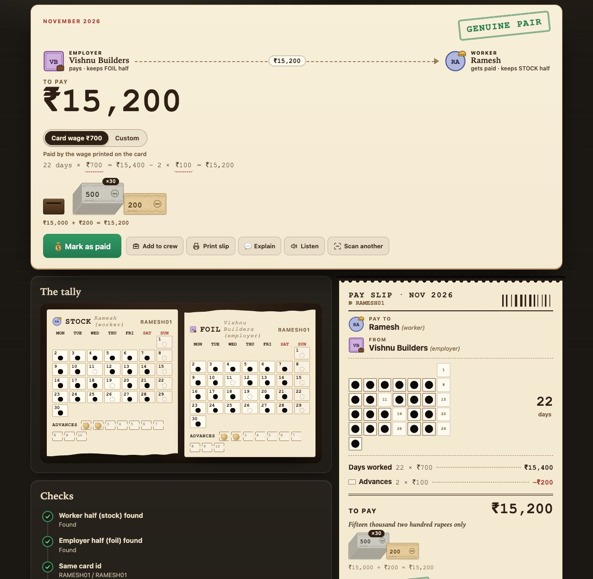
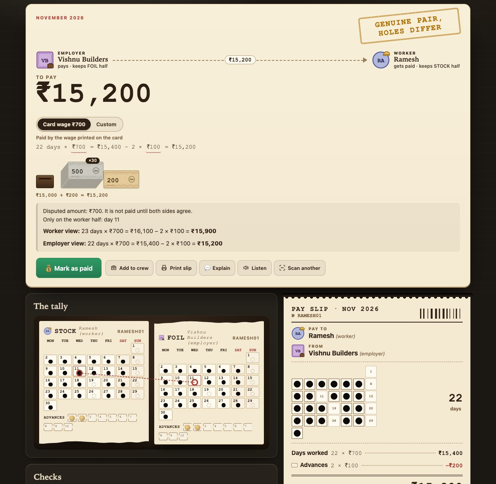

# Demo cards: a judge's test guide

Ready-made Stock & Foil cards for testing the app without making your own. Every image and PDF here was
generated by the app's own card generator and photo simulator (`npm run demo:cards`), and every set is read by
the real scanner in `tests/demoCards.test.ts`. The photos are simulator output, not real photographs.

## Try Stock & Foil in 1 minute

1. Open the live app: **https://vishnu2663.github.io/Stock-Foil-Kiro/**
2. Tap **Payday scan**.
3. Tap **Choose photos (one or both at once)** and pick both photos in [`1-genuine/`](1-genuine/).
4. You should see **Genuine pair** and **₹15,200** (22 days × ₹700 − 2 × ₹100).

Then try [`2-extra-hole/`](2-extra-hole/) to see a forged extra day caught.

## What's in this folder

All cards tell one story: worker **Ramesh**, employer **Vishnu Builders**, **₹700 a day**, advance token
**₹100**, **November 2026**.

| Folder | Files | What it shows |
|---|---|---|
| [`1-genuine/`](1-genuine/) | `stock.jpg`, `foil.jpg` | An honest pair: 22 days on both halves, 2 advances |
| [`2-extra-hole/`](2-extra-hole/) | `stock.jpg`, `foil.jpg` | The same card, but the worker half has one extra hole (day 11) |
| [`3-wrong-half/`](3-wrong-half/) | `stock.jpg`, `foil-from-another-card.jpg` | A worker half and an employer half from a different card |
| [`4-two-shifts/`](4-two-shifts/) | `stock.jpg`, `foil.jpg` | A half-day card (two circles per date): 20 full days and 1 half day |
| [`print/`](print/) | `blank-card.pdf`, `blank-card.png` | A blank card to print, cut and punch yourself |
| [`print/`](print/) | `punched-genuine.pdf` | Set 1 as two pages (worker half, employer half) to scan from a screen |
| [`expected.json`](expected.json) | | The expected result of every set, machine-readable |
| [`screens/`](screens/) | `set1-result.jpg`, `set2-result.jpg` | Screenshots of the app's result for sets 1 and 2 |

The photos are about 1600 px wide JPEGs (quality 88, about 300 KB each), slightly rotated and tilted like a
hand-held phone photo.

## Option A: No printer (upload the photos)

Works on a laptop or a phone.

1. Open https://vishnu2663.github.io/Stock-Foil-Kiro/ and go to **Payday scan**.
2. Tap **Choose photos (one or both at once)** and select both files of one set. You can also drag and drop
   them onto the page, or pick one half at a time.
3. The photos are read automatically. Compare the result with [Expected results](#expected-results).
4. Tap **Start again** before the next set.

Nothing is uploaded anywhere: the scan runs in your browser.

## Option B: Scan with your phone camera

1. On a computer, open [`print/punched-genuine.pdf`](print/punched-genuine.pdf) full screen. Page 1 is the
   worker half (stock), page 2 is the employer half (foil).
2. On your phone, open the live app, tap **Payday scan**, then **Start camera**, and allow the camera.
3. Point the phone at page 1 until the half is captured (it captures by itself), then show page 2.
4. The result should match set 1: **Genuine pair**, **₹15,200**.

What is tested: the test renders both pages to pixels from the same page drawing the PDF is made from, and
also photographs them with the simulator (7° rotation, tilt, blur); both read as set 1. The PDF file itself is
not opened by the test. A real phone pointed at a real screen adds glare, moiré and
screen brightness, which the test does not cover, so results may vary. Option A is the reliable path.

## Option C: The real thing (printer and hole punch)

1. Print [`print/blank-card.pdf`](print/blank-card.pdf) at **100% scale** (not "fit to page") on A4.
2. Cut along the dashed wavy line marked ✂ "cut here".
3. Stack the two halves, frames lined up, and punch a few day circles through **both halves together** with a
   standard 6 mm office punch.
4. Put each half on a **dark plain surface** (dark cloth or a dark table) and scan both with **Payday scan**.
   You should get **Genuine pair** with the days you punched.
5. Now punch one extra circle on one half only and scan again. You should get **Genuine pair, holes differ**,
   with that day listed and not paid.

The blank card has its own fixed card id (PR1NTCRD) and pairing code. A blank card you make yourself in
**New card** works the same way.

## Expected results

From [`expected.json`](expected.json):

| Set | Verdict shown | Days | Advances | Pay | Detail |
|---|---|---|---|---|---|
| 1-genuine | Genuine pair | 22 | 2 | **₹15,200** | 22 days × ₹700 − 2 × ₹100 = ₹15,200 |
| 2-extra-hole | Genuine pair, holes differ | 22 agreed | 2 | **₹15,200** | Day 11 is only on the worker half: flagged, not paid (₹700 disputed) |
| 3-wrong-half | Halves do not match | – | – | nothing | The two halves are from different cards: not a pair, nothing is paid |
| 4-two-shifts | Genuine pair | 20½ (20 full + 1 half) | 1 | **₹14,250** | 20½ days × ₹700 − 1 × ₹100 = ₹14,250 |
| punched-genuine.pdf | Genuine pair | 22 | 2 | **₹15,200** | Same as set 1 |

Set 1, uploaded to the live app (generated photos):

Set 2, with the extra hole on day 11 flagged:

## Tips if a scan does not work

- Use good, even light. In the camera view, the 🔦 button turns on the phone's light where supported.
- Keep the whole half in view, including all 4 corner squares.
- Hold still for a moment; a half is captured once it reads cleanly on 2 frames in a row.
- For a printed card, put it on a dark plain surface so the wavy cut edge and the holes show clearly.
- Keep fingers off the corner squares and the QR code.
- If the app says "unsure" or shows a warning, it is refusing to guess. Retake the photo, or tap an unsure
  circle to correct it by hand (it is then marked manual).

## How these files were made

- `npm run demo:cards` runs [`scripts/make-demo-cards.mjs`](../scripts/make-demo-cards.mjs). It loads the app's
  TypeScript through Vite and uses the card generator, the A4 sheet renderer, the PDF writer behind
  **New card → Download PDF**, and the photo simulator. The sheet rendering runs in headless Chrome, so
  regenerating needs Chrome installed (set `CHROME=/path/to/chrome` if it is not in the default place).
- The JPEGs are written by a small baseline JPEG encoder in [`src/render/jpeg.ts`](../src/render/jpeg.ts),
  so no extra dependency was added.
- Card ids and pairing secrets are fixed, and the simulator is seeded, so two runs give byte-identical files.
- [`tests/demoCards.test.ts`](../tests/demoCards.test.ts) decodes every committed JPEG, runs the real scanner
  and pay code on it, and checks the verdict, days, advances, pay and disputed days against `expected.json`.
  It also checks the two pages that `punched-genuine.pdf` is made from. The expected numbers are computed by plain arithmetic,
  not by the app's pay code.
- These are simulated photos. Real paper, punches and phones are covered by the checklist in
  [FIELD_TEST.md](../FIELD_TEST.md).
